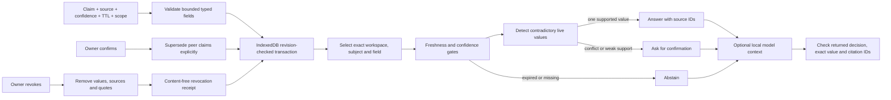

# Write, retrieve, forget

The browser owns the vault. The public Site serves static application files; it receives no memory writes. IndexedDB is actual persistent storage, not an in-memory demonstration. A bounded vault stores at most 100 claims and 400 content-free audit events. All destructive mutations work on a cloned candidate, then atomically save with the expected revision. UI state switches only after transaction completion. BroadcastChannel invalidates another open tab; revision comparison is the final write boundary.

Retrieval uses exact scope and subject matching before any answer. Freshness expires at `now >= freshUntil`. Declared confidence decays linearly by up to 35 percent over its TTL; effective confidence below 0.65 requests clarification. Any two different fresh values conflict, regardless of recency or confidence. Reconfirmation is an explicit owner operation, updates freshness and marks peer versions superseded.

Forgetting replaces each revoked claim with only its opaque ID, status and revocation time. It also removes superseded versions for a whole-workspace revocation. Audit events never contain values, source names or quotes. Retrieval and model context exclude revoked and superseded records. Exports serialize the current vault, so current exports do not contain revoked content. Previously downloaded copies, browser backups and external provider logs are outside this erasure boundary.

The local model receives values only for supported retrieval. For all other states it receives the field, scope, person, blocked-count and required decision with an empty evidence array. Its response cannot authorize writes or produce a different action. A model answer that names a nonexistent source, changes a value, answers from blocked memory or adds authority fields is refused. No remote source URLs or memory prose are executed.
