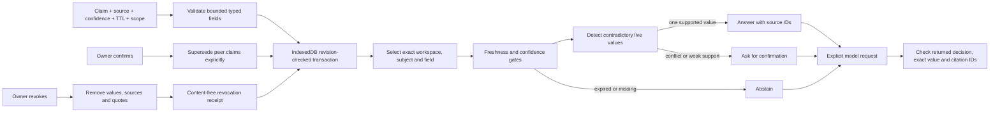

# Write, retrieve, forget

The browser owns the vault. IndexedDB is actual persistent storage. The public Vinext Worker does not store notebooks. It accepts explicit AI requests in a transient D1 queue, protected by a same-origin session and CSRF token. An authenticated outbound PC worker claims each job once, clears the queued input and calls DeepSeek through the genuine supported client. The provider key never leaves that PC. Results have a bounded lease and are validated again before delivery. Delivery, cancellation and timeout delete queued content; content-free cancellation tombstones prevent a cancel-before-enqueue race. Cleanup of abandoned rows is request-driven, not a guaranteed timed erasure service.

A bounded vault stores at most 100 claims and 400 content-free audit events. Mutations work on a cloned candidate, then atomically save with the expected revision. UI state switches only after transaction completion. BroadcastChannel invalidates another open tab; revision comparison is the final write boundary.

Retrieval uses exact scope and subject matching before any answer. Freshness expires at `now >= freshUntil`. Declared confidence decays linearly by up to 35 percent over its TTL; effective confidence below 0.65 requests clarification. Any two different fresh values conflict, regardless of recency or confidence. Reconfirmation is an explicit owner operation, updates freshness and marks peer versions superseded.

Forgetting replaces each revoked claim with only its opaque ID, status and revocation time. It also removes superseded versions for a whole-workspace revocation. Audit events never contain values, source names or quotes. Retrieval and model context exclude revoked and superseded records. Exports serialize the current vault, so current exports do not contain revoked content. Previously downloaded copies, browser backups and external provider logs are outside this erasure boundary.

Natural-language intake sends the entered note and source to DeepSeek. Extraction must return at most three allowlisted claims, with quotes found literally in the note and values present in those quotes. The user reviews and saves each selected proposal. Extraction has no write authority.

For questions, the model receives values only for supported retrieval. Other states have an empty evidence array. Its response must choose an allowlisted field and satisfy that field's decision contract. A model answer that names a nonexistent source, changes a value, answers from blocked memory or adds authority fields is refused. Before rendering, the browser checks the current revision, scope, subject and freshness again. Notes, questions and source prose are untrusted data; no source URL or prose is executed. Previously transmitted provider prompts cannot be recalled.
